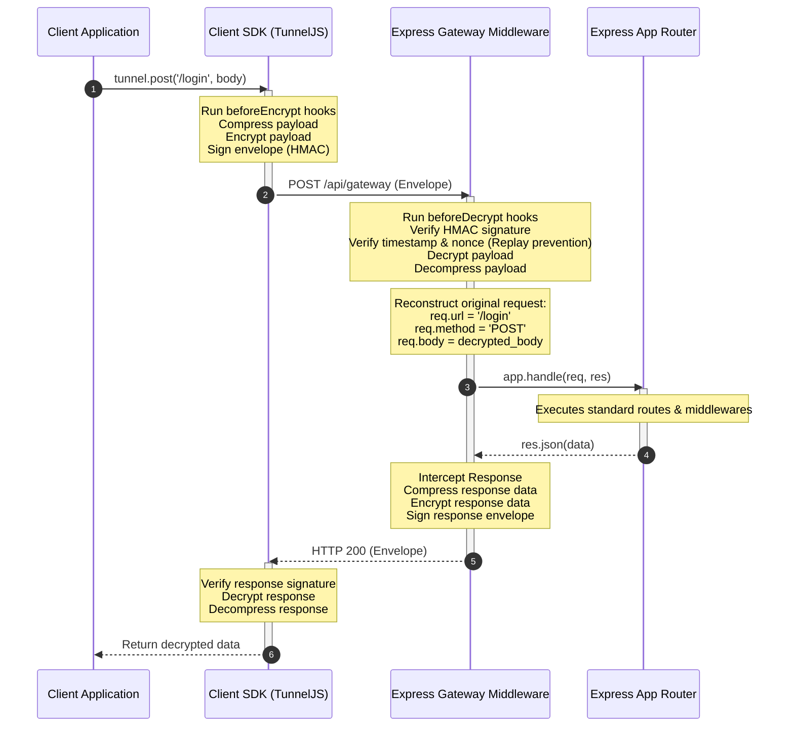

# Secure Tunnel (TunnelJS)

> **Transparent Application-Layer API Gateway for Node.js, Express & Client SDKs**

[](https://www.npmjs.com/)
[](https://opensource.org/licenses/MIT)
[]()

**Secure Tunnel** is a production-grade, transparent application-layer API gateway tunnel that sits between frontend applications and Express backends. It intercepts HTTP requests (such as GET, POST, PUT, DELETE) and bundles them into a single secure endpoint (`POST /api/gateway`) containing encrypted, compressed, and signed payloads.

This is **NOT** intended to replace HTTPS. HTTPS remains mandatory. Secure Tunnel provides an additional layer of request abstraction, centralized routing, payload encryption, request signing, replay protection, logging, and middleware extensibility.

---

## Features

- 🕵️ **Transparent Reconstruction**: Express routes and controllers require **zero modification**.
- 🔒 **End-to-End Encryption**: Pluggable support for AES-256-GCM (default) and ChaCha20-Poly1305.
- ✍️ **HMAC Request Signing**: Protects against tampering and unauthorized request execution.
- 🔄 **Replay Attack Protection**: Timed request expiration + cache-backed nonce validation (Memory & Redis).
- 🗜️ **Payload Compression**: Automatic Gzip & Brotli compression before encryption.
- 🔌 **Lifecycle Plugin System**: Extensible hook architecture for tracing, metrics, custom logging, and rate limiting.
- 📦 **Monorepo Packages**: Modular design with separate lightweight packages.

---

## Monorepo Packages

| Package | Purpose |
| :--- | :--- |
| **`@secure-tunnel/core`** | Interface definitions, base error classes, and plugin registry. |
| **`@secure-tunnel/express`** | Express middleware that intercepts requests and handles internal forwarding. |
| **`@secure-tunnel/client`** | Client SDK containing fetch clients, Axios adapters, and React hooks. |
| **`@secure-tunnel/crypto`** | Cryptographic providers for symmetric ciphers, HMAC signatures, and cache nonces. |
| **`@secure-tunnel/compression`** | Gzip and Brotli compression engines. |
| **`@secure-tunnel/logger`** | Structured JSON logs and telemetry. |
| **`@secure-tunnel/plugins`** | Built-in plugins (Tracing, Rate Limiting, Metrics, Authenticating, etc.). |

---

## Installation

```bash
# On the Express server
pnpm add @secure-tunnel/express @secure-tunnel/client

# On the frontend client
pnpm add @secure-tunnel/client
```

---

## Quick Start

### 1. Express Gateway Server Setup

Mount the gateway middleware on your Express application. Express routes remain standard and unaltered.

```typescript
import express from 'express';
import { createTunnelGateway } from '@secure-tunnel/express';

const app = express();

// Parse json body for the gateway endpoint
app.use(express.json());

// Set up Secure Tunnel gateway
app.use(
  createTunnelGateway({
    endpoint: '/api/gateway',
    secretKey: 'your-256-bit-shared-secret-key-goes-here!',
    signatureKey: 'your-hmac-signature-shared-key!',
    encryption: true,
    signing: true,
    compression: true,
    replayProtection: true,
  })
);

// Standard routes - completely unaware of the tunnel
app.get('/api/products', (req, res) => {
  res.json([{ id: 1, name: 'Premium Coffee' }]);
});

app.post('/api/orders', (req, res) => {
  res.status(201).json({ orderId: 99, status: 'processed' });
});

app.listen(3000, () => console.log('Secure Tunnel gateway online at port 3000'));
```

### 2. Client SDK Setup

#### Fetch Client
Use the client SDK to dispatch requests. All traffic goes through `/api/gateway`.

```typescript
import { createTunnel } from '@secure-tunnel/client';

const tunnel = createTunnel({
  endpoint: 'http://localhost:3000/api/gateway',
  secretKey: 'your-256-bit-shared-secret-key-goes-here!',
  signatureKey: 'your-hmac-signature-shared-key!',
  encryption: true,
  signing: true,
  compression: true,
});

// Fetching standard API endpoints transparently
const products = await tunnel.get('/api/products');
console.log(products); // [{ id: 1, name: 'Premium Coffee' }]

const newOrder = await tunnel.post('/api/orders', { quantity: 2 });
console.log(newOrder); // { orderId: 99, status: 'processed' }
```

#### Axios Integration
Hook into your existing Axios instances to tunnel all traffic seamlessly:

```typescript
import axios from 'axios';
import { createTunnel, applyAxiosInterceptor } from '@secure-tunnel/client';

const api = axios.create({
  baseURL: 'http://localhost:3000',
});

const tunnelClient = createTunnel({
  endpoint: 'http://localhost:3000/api/gateway',
  secretKey: 'your-secret-key',
  signatureKey: 'your-sig-key',
});

// Apply interceptor
applyAxiosInterceptor(api, tunnelClient);

// Now standard Axios calls are transparently tunneled!
const res = await api.get('/api/products');
console.log(res.data);
```

#### React / Next.js Hook
Wrap your root component with the `TunnelProvider`:

```tsx
import React from 'react';
import { createTunnel, TunnelProvider, useTunnel } from '@secure-tunnel/client';

const client = createTunnel({
  endpoint: '/api/gateway',
  secretKey: 'your-secret-key',
  signatureKey: 'your-sig-key',
});

export function App() {
  return (
    <TunnelProvider client={client}>
      <ProductList />
    </TunnelProvider>
  );
}

function ProductList() {
  const tunnel = useTunnel();
  const [products, setProducts] = React.useState([]);

  React.useEffect(() => {
    tunnel.get('/api/products').then(setProducts);
  }, [tunnel]);

  return (
    <ul>
      {products.map((p: any) => <li key={p.id}>{p.name}</li>)}
    </ul>
  );
}
```

---

## Architecture Sequence



---

## Security Guidelines & Considerations

> [!WARNING]
> Secure Tunnel is an application-layer defense and **must never** be used to replace transport-layer security (HTTPS).

1. **Mandatory HTTPS**: Secure Tunnel does not hide the IP address, connection size, or timing of HTTP packets. Running without HTTPS exposes payloads to metadata harvesting and routing spoofing.
2. **Key Storage inside Browsers**: Storing static symmetric keys (`secretKey`) inside browser local storage, cookies, or frontend source code is vulnerable to XSS extraction.
   - **Recommendation**: Authenticate clients first, and derive unique session-specific keys on-demand or use asymmetric wrappers.
3. **Session Tokens**: Continue to use standard JWT or short-lived authorization headers. You can register our built-in `AuthenticationPlugin` to validate tokens directly inside the gateway layer prior to routing.
4. **Replay Protection**: Always configure `replayProtection` with an active cache provider (like Redis) in clustered, multi-server production environments.

---

## Custom Plugin Implementation

Secure Tunnel allows writing custom plugins implementing the `TunnelPlugin` interface.

```typescript
import { TunnelPlugin, TunnelRequest, TunnelPluginContext } from '@secure-tunnel/core';

export class CustomHeaderPlugin implements TunnelPlugin {
  public readonly name = 'custom-header-plugin';

  public async beforeForward(request: TunnelRequest, context: TunnelPluginContext): Promise<void> {
    // Inject a special header to downstream route controllers
    request.headers['x-secure-gateway-vetted'] = 'true';
  }

  public async afterForward(response: any, context: TunnelPluginContext): Promise<void> {
    // Audit response object
    console.log('Outgoing response intercepted:', response);
  }
}
```

Register your custom plugin during gateway setup:

```typescript
app.use(
  createTunnelGateway({
    endpoint: '/api/gateway',
    plugins: [new CustomHeaderPlugin()],
  })
);
```

---

## License

MIT License.
