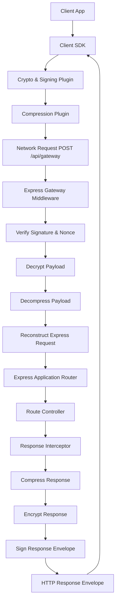

# Architecture & Lifecycle

Secure Tunnel (TunnelJS) acts as a transparent proxy layer. It operates by converting standard, multi-endpoint HTTP traffic into a unified payload-based gateway tunnel (`POST /api/gateway`).

## Component Diagram

## Middleware Lifecycle Hooks

The tunnel executes a series of sequential plugin hooks on both request and response paths.

### 1. Request Flow (Incoming to Server)
1. **`beforeDecrypt(envelope, context)`**: Fires immediately on receiving the envelope. Use this for:
   - Validating HMAC request signatures (`SignaturePlugin`)
   - Nonce validation & Timestamp validation (`ReplayProtectionPlugin`)
   - Decrypting the payload (`EncryptionPlugin`)
2. **`afterDecrypt(request, context)`**: Fires after the payload has been decrypted.
   - Decompressing payload (`CompressionPlugin`)
3. **`beforeForward(request, context)`**: Fires before the reconstructed request is sent to Express router.
   - Injecting custom tracing headers (`TracingPlugin`)
   - Verifying authorization tokens (`AuthenticationPlugin`)

### 2. Response Flow (Outgoing from Server)
1. **`afterForward(response, context)`**: Fires after the inner Express route handler has completed execution.
   - Auditing response payloads or recording telemetry metrics (`MetricsPlugin`).
2. **`beforeEncrypt(envelope, context)`**: Fires before payload encryption.
   - Compressing response body (`CompressionPlugin`).
3. **`afterEncrypt(envelope, context)`**: Fires after payload is encrypted.
   - Generating response signatures (`SignaturePlugin`).
   - Logging response metrics (`LoggerPlugin`).
